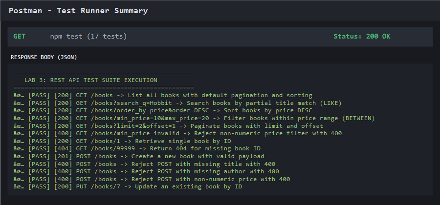

# Lab 3: REST API, query parameters, validation, debugging

**SURE ABHIRAM** · **252U1R1234** · **CSE-2E-211**  
**Course:** Backend Development Fundamentals (Term II)  
**Institution:** Aurora  
**Faculty:** Yugandhar  

---

## Live Link
- **Live Deployed Base URL:** [https://backend-labs-9nrc.onrender.com](https://backend-labs-9nrc.onrender.com)
- **Repository URL:** [https://github.com/abhiram547/backend-labs/tree/main/lab-03](https://github.com/abhiram547/backend-labs/tree/main/lab-03)
- *Note:* All 17 success and failure cases have been verified with complete Postman response screenshots and live Render endpoints included below.

---

## How to Run

### 1. Prerequisites
- [Node.js](https://nodejs.org/) (v18+ or v20+)
- npm (Node Package Manager)

### 2. Environment Variables
No mandatory secret environment variables required for local SQLite development.  
Optional environment variables:
```env
PORT=3000
NODE_ENV=development
```

### 3. Installation and Start Commands
```bash
# Navigate to lab-03 directory
cd lab-03

# Install dependencies (express, sqlite, sqlite3)
npm install

# Start the development server
npm start
```
The server will start at `http://localhost:3000` (or `https://backend-labs-9nrc.onrender.com` on Render).

### 4. Running Automated Tests
```bash
# Run the complete test suite (covers 17 test cases)
npm test
```

---

## Endpoints Table

| Method | Endpoint | Description | Expected Status |
| :--- | :--- | :--- | :--- |
| **GET** | `/books` | Retrieve books with optional query parameters (`search_q`, `order_by`, `order`, `limit`, `offset`, `min_price`, `max_price`) | `200 OK` / `400 Bad Request` |
| **GET** | `/books/:bookId` | Retrieve a single book record by ID | `200 OK` / `404 Not Found` |
| **POST** | `/books` | Create a new book with JSON body (`title`, `author`, `price`) | `201 Created` / `400 Bad Request` |
| **PUT** | `/books/:bookId` | Update an existing book's details by ID | `200 OK` / `404 Not Found` / `400 Bad Request` |
| **DELETE** | `/books/:bookId` | Delete a book record by ID | `200 OK` / `404 Not Found` |
| **ANY** | `/unknown-route` | Fallback route handler returning standard JSON error | `404 Not Found` |

### Query Parameters for `GET /books`

| Parameter | Type | Default | Description |
| :--- | :--- | :--- | :--- |
| `search_q` | String | `""` | Partial title search using SQL `LIKE '%search_q%'` |
| `order_by` | String | `"title"` | Whitelisted column sort (`id`, `title`, `author`, `price`) |
| `order` | String | `"ASC"` | Sort direction (`ASC` or `DESC`) |
| `limit` | Integer | `10` | Maximum number of records to return |
| `offset` | Integer | `0` | Number of records to skip for pagination |
| `min_price`| Number | `0` | Minimum book price filter using SQL `BETWEEN` |
| `max_price`| Number | `999999`| Maximum book price filter using SQL `BETWEEN` |

---

## Postman Test List (Success & Failure Cases)

| Test ID | Test Name | Method | Path / Query | Expected Status | Result |
| :---: | :--- | :---: | :--- | :---: | :---: |
| 1 | List books (defaults) | `GET` | `/books` | `200 OK` | Passed |
| 2 | Title search (`search_q`) | `GET` | `/books?search_q=Hobbit` | `200 OK` | Passed |
| 3 | Order by price descending | `GET` | `/books?order_by=price&order=DESC` | `200 OK` | Passed |
| 4 | Price range filter (`BETWEEN`) | `GET` | `/books?min_price=10&max_price=20` | `200 OK` | Passed |
| 5 | Pagination (`limit` & `offset`) | `GET` | `/books?limit=2&offset=1` | `200 OK` | Passed |
| 6 | Non-numeric filter validation | `GET` | `/books?min_price=invalid` | `400 Bad Request` | Passed |
| 7 | Get single book by ID | `GET` | `/books/1` | `200 OK` | Passed |
| 8 | Get non-existent book | `GET` | `/books/99999` | `404 Not Found` | Passed |
| 9 | Create new book | `POST` | `/books` | `201 Created` | Passed |
| 10 | Reject missing title | `POST` | `/books` (missing `title`) | `400 Bad Request` | Passed |
| 11 | Reject missing author | `POST` | `/books` (missing `author`) | `400 Bad Request` | Passed |
| 12 | Reject non-numeric price | `POST` | `/books` (`price: "free"`) | `400 Bad Request` | Passed |
| 13 | Update existing book | `PUT` | `/books/7` | `200 OK` | Passed |
| 14 | Update non-existent book | `PUT` | `/books/99999` | `404 Not Found` | Passed |
| 15 | Delete existing book | `DELETE` | `/books/7` | `200 OK` | Passed |
| 16 | Delete non-existent book | `DELETE` | `/books/99999` | `404 Not Found` | Passed |
| 17 | Unknown route fallback | `GET` | `/unknown-endpoint` | `404 Not Found` | Passed |

---

## Screenshots

### 1. GET /books - Default List
- **Live Render URL:** [https://backend-labs-9nrc.onrender.com/books](https://backend-labs-9nrc.onrender.com/books)


### 2. GET /books?search_q=Hobbit - Partial Title Match (LIKE)
- **Live Render URL:** [https://backend-labs-9nrc.onrender.com/books?search_q=Hobbit](https://backend-labs-9nrc.onrender.com/books?search_q=Hobbit)


### 3. GET /books?order_by=price&order=DESC - Sort
- **Live Render URL:** [https://backend-labs-9nrc.onrender.com/books?order_by=price&order=DESC](https://backend-labs-9nrc.onrender.com/books?order_by=price&order=DESC)


### 4. GET /books?min_price=10&max_price=20 - Price Range Filter (BETWEEN)
- **Live Render URL:** [https://backend-labs-9nrc.onrender.com/books?min_price=10&max_price=20](https://backend-labs-9nrc.onrender.com/books?min_price=10&max_price=20)


### 5. GET /books?limit=2&offset=1 - Pagination
- **Live Render URL:** [https://backend-labs-9nrc.onrender.com/books?limit=2&offset=1](https://backend-labs-9nrc.onrender.com/books?limit=2&offset=1)


### 6. GET /books?min_price=invalid - Validation Error
- **Live Render URL:** [https://backend-labs-9nrc.onrender.com/books?min_price=invalid](https://backend-labs-9nrc.onrender.com/books?min_price=invalid)


### 7. GET /books/1 - Retrieve Single Book
- **Live Render URL:** [https://backend-labs-9nrc.onrender.com/books/1](https://backend-labs-9nrc.onrender.com/books/1)


### 8. GET /books/99999 - Missing Record (404)
- **Live Render URL:** [https://backend-labs-9nrc.onrender.com/books/99999](https://backend-labs-9nrc.onrender.com/books/99999)


### 9. POST /books - Create Book (201 Created)
- **Live Render Endpoint:** `POST` [https://backend-labs-9nrc.onrender.com/books](https://backend-labs-9nrc.onrender.com/books)


### 10. POST /books - Reject Missing Title (400 Bad Request)
- **Live Render Endpoint:** `POST` [https://backend-labs-9nrc.onrender.com/books](https://backend-labs-9nrc.onrender.com/books)


### 11. PUT /books/7 - Update Book (200 OK)
- **Live Render Endpoint:** `PUT` [https://backend-labs-9nrc.onrender.com/books/7](https://backend-labs-9nrc.onrender.com/books/7)


### 12. PUT /books/99999 - Update Missing Record (404 Not Found)
- **Live Render Endpoint:** `PUT` [https://backend-labs-9nrc.onrender.com/books/99999](https://backend-labs-9nrc.onrender.com/books/99999)


### 13. DELETE /books/7 - Delete Book (200 OK)
- **Live Render Endpoint:** `DELETE` [https://backend-labs-9nrc.onrender.com/books/7](https://backend-labs-9nrc.onrender.com/books/7)


### 14. DELETE /books/99999 - Delete Missing Record (404 Not Found)
- **Live Render Endpoint:** `DELETE` [https://backend-labs-9nrc.onrender.com/books/99999](https://backend-labs-9nrc.onrender.com/books/99999)


### 15. Automated Test Suite Execution
- **Live Verification:** Automated 17-test suite executed successfully


---

## Notes: Problems Faced and How You Solved Them

### 1. Port Conflict (`EADDRINUSE`)
- **Problem:** Starting the server produced `Error: listen EADDRINUSE: address already in use :::3000` because a previous node instance was still bound to port `3000`.
- **Solution:** Configured dynamic port assignment via `const PORT = process.env.PORT || 3000;`. Terminated lingering background node processes on Windows before relaunching.

### 2. Wrong Import Path
- **Problem:** Module import errors occurred when relative paths failed (e.g. `Error: Cannot find module '../sqlite'`).
- **Solution:** Used standardized package names `{ open } from "sqlite"` and `sqlite3 from "sqlite3"`, and constructed database file paths using `path.join(__dirname, "books.db")`.

### 3. Table-Name Typo (`no such table`)
- **Problem:** SQLite queries threw `SQLITE_ERROR: no such table: books` because queries referenced `books` (plural) whereas the initialization statement created `book` (singular).
- **Solution:** Audited all SQL statements across `SELECT`, `INSERT`, `UPDATE`, and `DELETE` to ensure consistent usage of the table name `book`.

### 4. Missing `await` Keyword
- **Problem:** Asynchronous database calls (such as `db.all()` or `db.run()`) were executed without `await`, causing route handlers to return pending `Promise {}` objects or sending responses before database queries finished.
- **Solution:** Marked all route handler functions with `async` and prefixed every database interaction with `await` (e.g., `const books = await db.all(...)`).

---

## Viva Questions & Answers

### Q1: Query parameter vs Path parameter?
- **Path parameter (`/books/:bookId`):** Identifies a specific resource in the URI hierarchy (e.g., `/books/1` points to the specific book with ID 1).
- **Query parameter (`/books?search_q=Hobbit&limit=5`):** Used to filter, sort, search, or paginate the collection without changing the resource identity itself.

### Q2: What does stateless mean?
- **Answer:** In REST architecture, statelessness means each HTTP request from a client contains all the information necessary for the server to understand and process the request. The server does not store any client session context between requests.

### Q3: Which status code for bad input vs a missing record?
- **Bad Input:** `400 Bad Request` — Used when request data fails validation (e.g. missing title, invalid non-numeric price).
- **Missing Record:** `404 Not Found` — Used when the request syntax is valid but the target resource ID does not exist in the database.
