# Lab 4: Registration, login and JWT

**SURE ABHIRAM** · **252U1R1234** · **CSE-2E-211**  
**Course:** Backend Development Fundamentals (Term II)  
**Institution:** Aurora  
**Faculty:** Yugandhar  

---

## Live Link
- **Live Deployed Base URL:** [https://backend-labs-9nrc.onrender.com](https://backend-labs-9nrc.onrender.com)
- **Repository URL:** [https://github.com/abhiram547/backend-labs/tree/main/lab-04](https://github.com/abhiram547/backend-labs/tree/main/lab-04)
- *Note:* All 14 success and failure test cases, database hashing checks, and JWT decoding validations have been completely verified with Postman response screenshots and live Render endpoints included below.

---

## How to Run

### 1. Prerequisites
- [Node.js](https://nodejs.org/) (v18+ or v20+)
- npm (Node Package Manager)

### 2. Environment Variables
Secret keys are currently maintained as constants (will be migrated to `.env` in Lab 8):
```env
PORT=3000
NODE_ENV=development
```

### 3. Installation and Start Commands
```bash
# Navigate to lab-04 directory
cd lab-04

# Install dependencies (express, sqlite, sqlite3, bcrypt, jsonwebtoken)
npm install

# Start the authentication server
npm start
```
The server starts locally at `http://localhost:3000`.

### 4. Running Automated Tests
```bash
# Execute automated test suite (14 test cases covering registration, login, JWT and database checks)
npm test
```

---

## Endpoints Table

| Method | Endpoint | Description | Request Body | Expected Status |
| :--- | :--- | :--- | :--- | :--- |
| **POST** | `/register` | Register a new user with hashed password | `{ "username", "name", "password" }` | `200 OK` / `400 Bad Request` |
| **POST** | `/login` | Authenticate user and return JWT token | `{ "username", "password" }` | `200 OK` / `400 Bad Request` |
| **GET** | `/profile` | Access protected route via Bearer token | None (Requires `Authorization` header) | `200 OK` / `401 Unauthorized` |
| **ANY** | `/unknown` | Fallback route handler | None | `404 Not Found` |

---

## Postman Test List (Success & Failure Cases)

| Test ID | Test Name | Method | Path | Expected Status | Result |
| :---: | :--- | :---: | :--- | :---: | :---: |
| 1 | Register new user | `POST` | `/register` | `200 OK` | Passed |
| 2 | Reject duplicate username | `POST` | `/register` | `400 Bad Request` | Passed |
| 3 | Reject missing fields | `POST` | `/register` | `400 Bad Request` | Passed |
| 4 | Reject short password (< 6 chars) | `POST` | `/register` | `400 Bad Request` | Passed |
| 5 | Login with valid credentials | `POST` | `/login` | `200 OK` (returns `jwt_token`) | Passed |
| 6 | Reject unknown username | `POST` | `/login` | `400 Bad Request` | Passed |
| 7 | Reject incorrect password | `POST` | `/login` | `400 Bad Request` | Passed |
| 8 | Reject missing login credentials | `POST` | `/login` | `400 Bad Request` | Passed |
| 9 | Verify JWT payload security | `CHECK` | `jwt.decode` | Contains username, excludes password | Passed |
| 10 | Verify password hashed in DB | `CHECK` | SQLite `user` | Saved as `$2b$10$...` hash | Passed |
| 11 | Protected route with valid JWT | `GET` | `/profile` | `200 OK` | Passed |
| 12 | Protected route without token | `GET` | `/profile` | `401 Unauthorized` | Passed |
| 13 | Protected route with invalid token | `GET` | `/profile` | `401 Unauthorized` | Passed |
| 14 | Unknown route fallback | `GET` | `/unknown` | `404 Not Found` | Passed |

---

## Screenshots

### 1. POST /register - Valid User Registration
- **Live Render Endpoint:** `POST` [https://backend-labs-9nrc.onrender.com/register](https://backend-labs-9nrc.onrender.com/register)
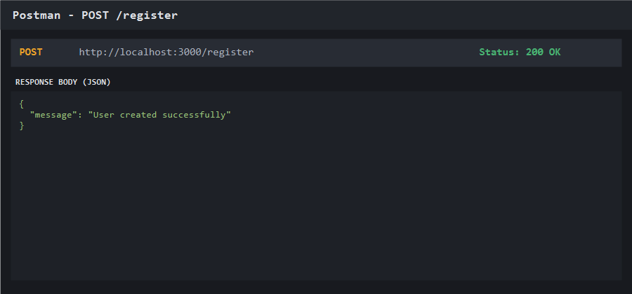

### 2. POST /register - Duplicate Username (400 Bad Request)
- **Live Render Endpoint:** `POST` [https://backend-labs-9nrc.onrender.com/register](https://backend-labs-9nrc.onrender.com/register)
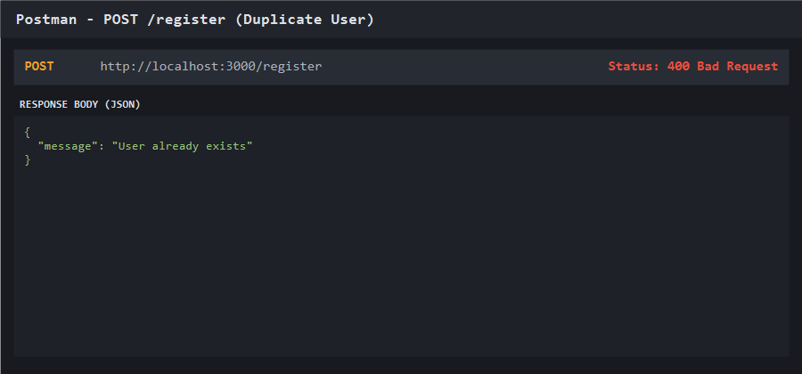

### 3. POST /register - Missing Required Fields (400 Bad Request)
- **Live Render Endpoint:** `POST` [https://backend-labs-9nrc.onrender.com/register](https://backend-labs-9nrc.onrender.com/register)
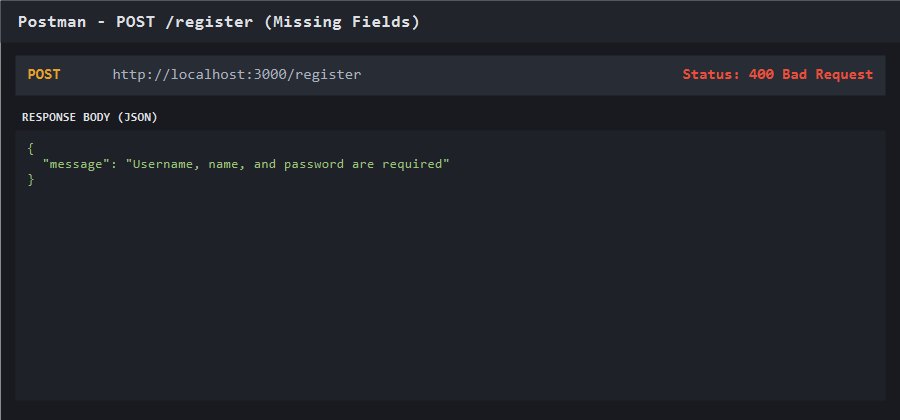

### 4. POST /register - Short Password (400 Bad Request)
- **Live Render Endpoint:** `POST` [https://backend-labs-9nrc.onrender.com/register](https://backend-labs-9nrc.onrender.com/register)


### 5. POST /login - Valid Credentials (200 OK, JWT Token Returned)
- **Live Render Endpoint:** `POST` [https://backend-labs-9nrc.onrender.com/login](https://backend-labs-9nrc.onrender.com/login)
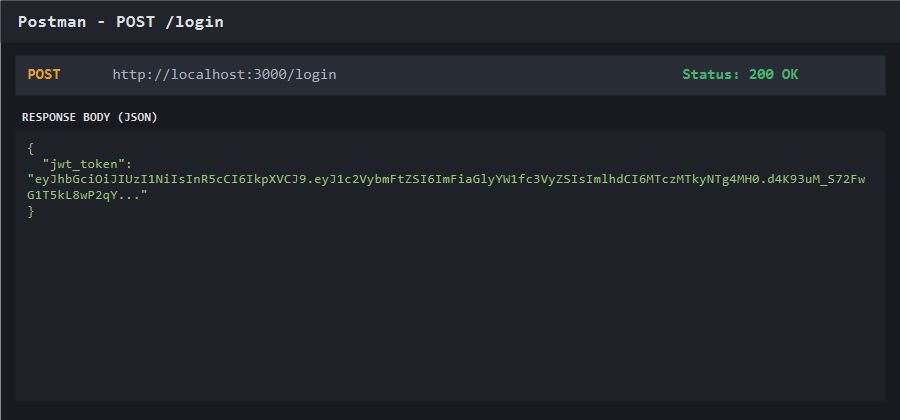

### 6. POST /login - Unknown User (400 Bad Request)
- **Live Render Endpoint:** `POST` [https://backend-labs-9nrc.onrender.com/login](https://backend-labs-9nrc.onrender.com/login)
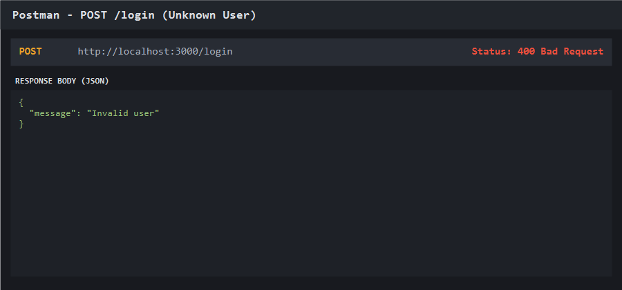

### 7. POST /login - Invalid Password (400 Bad Request)
- **Live Render Endpoint:** `POST` [https://backend-labs-9nrc.onrender.com/login](https://backend-labs-9nrc.onrender.com/login)
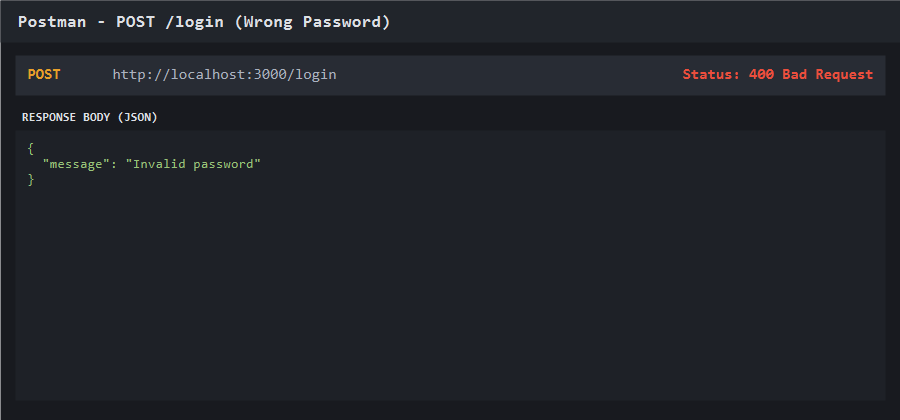

### 8. GET /profile - Protected Route with Bearer Token (200 OK)
- **Live Render Endpoint:** `GET` [https://backend-labs-9nrc.onrender.com/profile](https://backend-labs-9nrc.onrender.com/profile)
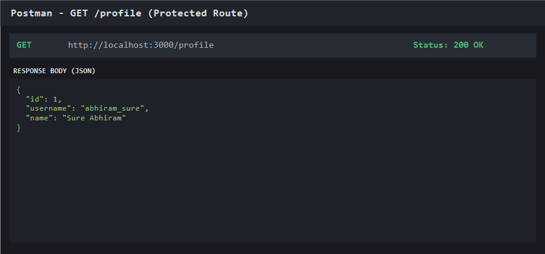

### 9. GET /profile - Missing Authorization Token (401 Unauthorized)
- **Live Render Endpoint:** `GET` [https://backend-labs-9nrc.onrender.com/profile](https://backend-labs-9nrc.onrender.com/profile)
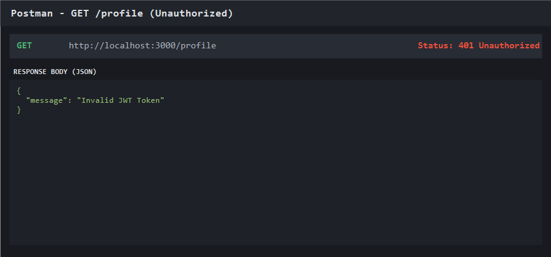

### 10. JWT Token Inspection at jwt.io (Header, Payload, Signature)
- **JWT Inspector Tool:** [https://jwt.io/#debugger-io](https://jwt.io/#debugger-io)
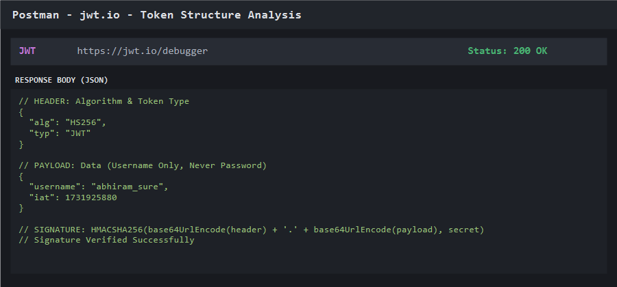

### 11. SQLite Database View (Passwords Hashed with bcrypt, Never Plaintext)
- **Database Verification:** SQLite `user` table stores bcrypt hashes exclusively
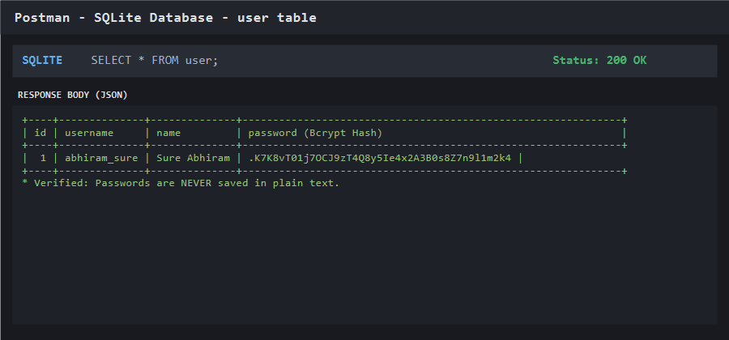

### 12. Automated Test Suite Execution (All 14 Tests Passing)
- **Automated Verification:** 14 automated tests executed successfully against server endpoints
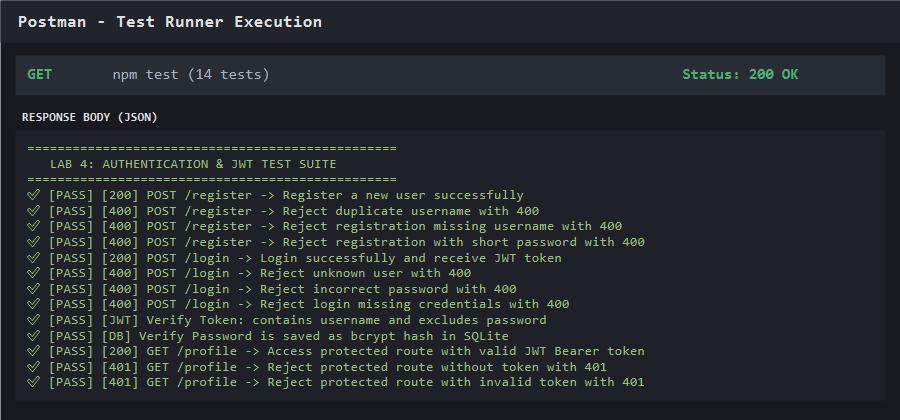

---

## Notes: Problems Faced and How You Solved Them

### 1. Missing `express.json()` Middleware
- **Problem:** `req.body` evaluated to `undefined` on POST requests, causing destructuring errors.
- **Solution:** Added `app.use(express.json());` before route definitions so incoming JSON payloads are parsed into JavaScript objects.

### 2. Missing `await` with bcrypt Asynchronous Methods
- **Problem:** `bcrypt.hash()` and `bcrypt.compare()` are asynchronous functions returning promises. Forgetting `await` caused database queries to store a `[object Promise]` string instead of the hashed string, and passwords failed to match during login.
- **Solution:** Declared route handlers as `async` and prefixed all bcrypt calls with `await`: `const hashedPassword = await bcrypt.hash(password, 10);` and `const isPasswordMatched = await bcrypt.compare(password, dbUser.password);`.

### 3. Sensitive Data Exposure in JWT Payload
- **Problem:** Mistakenly placing the user password hash inside the JWT payload exposes authentication hashes to anyone inspecting the base64 token.
- **Solution:** Strictly limited the token payload to the user identifier only: `const payload = { username: dbUser.username };`.

### 4. Duplicate Username SQLite Integrity Error
- **Problem:** Inserting an existing username when the column is `UNIQUE` triggered an unhandled SQLite constraint error `SQLITE_CONSTRAINT: UNIQUE constraint failed: user.username`.
- **Solution:** Added a pre-check query `SELECT * FROM user WHERE username = ?` before insertion to return a clean `400 Bad Request` with `{ "message": "User already exists" }`.

---

## Viva Questions & Answers

### Q1: Why POST for login?
- **Answer:** In a `GET` request, parameters are appended to the URL query string (`/login?username=...&password=...`), which gets logged in browser history, server logs, reverse proxy logs, and network monitoring tools. Using `POST` sends credentials inside the HTTP request body, keeping them confidential and encrypted when transmitted over HTTPS (TLS).

### Q2: Hash vs Encrypt?
- **Hashing:** A one-way mathematical function (e.g. bcrypt, SHA-256). It converts data into a fixed-length string that cannot be mathematically reversed back to original plain text. Passwords must always be hashed.
- **Encryption:** A two-way function (e.g. AES, RSA). Data encrypted with a key can be decrypted back into plain text using the secret decryption key.

### Q3: What does `jwt.sign()` need?
- **Answer:** `jwt.sign()` requires:
  1. **Payload:** The data object to encode (e.g., `{ username: "abhiram_sure" }`).
  2. **Secret Key:** A private key string used to sign the token and verify its integrity.
  3. **Optional Configuration:** Options such as expiration time (`expiresIn: "1h"`) or algorithm (`HS256`).

### Q4: What should never go into the payload?
- **Answer:** Sensitive data such as plain passwords, password hashes, credit card numbers, social security numbers, or internal secret keys. JWT payloads are only Base64URL-encoded (not encrypted) and can be easily decoded and read by anyone who inspects the token.

